# Вітальня — домашній екран для Android TV

Лаунчер для Android TV-приставок (зроблений і перевірений на Xiaomi Mi Box S), який показує те, що
важливо в Україні просто зараз: карту повітряних тривог з шахедами й ракетами в реальному часі,
лінію фронту, графік відключень світла, погоду, курси, новини — і полицю з вашими програмами.

**Завантажити APK:** [tvhome.pichkur.com](https://tvhome.pichkur.com) або [Releases](https://github.com/yevheniipichkur/tvhome-launcher/releases/latest) (повна й Lite)

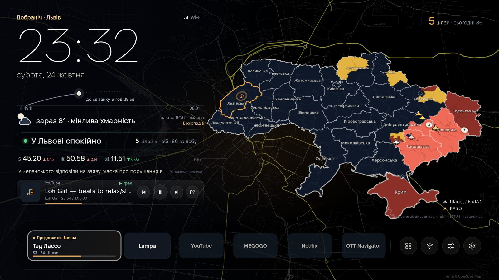

*English: a home screen (launcher) for Android TV boxes made for Ukraine — a live air-raid alert map
with Shahed/missile tracks, the DeepStateMAP front line, power-outage schedules, weather, NBU rates,
news and an app shelf. The UI is in Ukrainian. MIT licensed.*

## Що вміє

- **Карта тривог** по областях, районах і громадах — ті самі офіційні дані, що й на
  map.ukrainealarm.com. Цілі в небі (шахеди, реактивні, ракети, КАБи) з напрямком руху від NEPTUN.
- **Тривога у вашому місті:** карта плавно наближається до міста, по краях екрана — м'яке червоне
  світіння, а поверх будь-якої програми (YouTube, фільм) з'являється «чубчик», як Dynamic Island.
- **Лінія фронту** DeepStateMAP замість карти тривог (перемикач у налаштуваннях): окуповане,
  сіра зона, зміни за добу кільцями на карті та відтворення змін за тиждень, день за днем.
- **Погода на карті** — третій шар карти: дощ, сніг і хмари над усією Україною та температура в обласних центрах.
- **Порівняння фронту** — пунктиром лінія фронту місяць тому поверх сьогоднішньої.
- **Футбол** — матч обраної команди (збірна або клуб УПЛ) у рядку новин: «сьогодні 14:00», рахунок наживо, фінал.
- **Налаштування з розділами** (Екран · Карта · Полиця · Дані · Система): значки й пояснення до кожного пункту, перемикачі, а екран поруч — зміни видно одразу. «Про приставку»: пам’ять, сховище, температура, IP. «Звільнити пам’ять» закриває фонові програми.
- **Пульт і клавіатура з телефону** (повна й Lite): лаунчер сам піднімає в домашній мережі сторінку `http://<приставка>:8765` — QR-код і шестизначний код у Налаштуваннях → Телефон. Головне — клавіатура: «Вітальня: клавіатура з телефону» вписує текст із телефону в будь-яке поле на телевізорі (пошук YouTube, Lampa, пароль Wi‑Fi), кирилицею теж. Ще стрілки й ОК, Назад/Додому, медіа, гучність, запуск програм. Стрілки в чужих програмах працюють через мережеве налагодження самої приставки (один раз «Дозволити» на екрані).
- **Швидкі налаштування** — кнопка на полиці: гучність, шар карти, макет, тема, яскравість фону, звуки, мережа.
- **Гучність у «чубчику»** замість системної шкали (повна версія).
- **Майстер першого запуску:** місто визначається саме, вибір програм для полиці, черга світла й команда, головний екран із поясненням, усі дозволи на одному екрані, підказки. Пройти знову — Налаштування → Екран.
- **Конструктор екрана** (Налаштування → Конструктор екрана): будь-який блок можна сховати, перемістити й зробити меншим чи більшим; нові блоки — тиждень, футбол з емблемами, фронт за добу, відлік днів, нотатка, фото дня Вікіпедії, другий годинник. Права частина — карта, великий годинник, фото дня, календар або нічого. Полиця — розмір карток, підписи, один чи два ряди, які кнопки показувати. Колір акценту (12), годинник (тонкий, жирний, табло, стрілки, словами), шрифт, панелі, кути, рамки. «Скинути все» повертає як було.
- **Меню програми:** затисніть ОК на програмі (або кнопку меню) — відкрити, перемістити на полиці, прибрати з полиці, інформація, видалити.
- **Стан інтернету:** значок Wi‑Fi жовтіє, коли інтернет повільний, і червоніє, коли його немає; у налаштуваннях — вимір швидкості (Cloudflare).
- **Нічне місто:** уночі вулиці на фоні світяться теплим світлом.
- **Святкове оформлення:** гірлянда над полицею на Новий рік і синьо-жовті акценти в державні свята (вимикається в налаштуваннях).
- **Свята й пам'ятні дні** біля дати (Великдень і Трійця рахуються самі).
- **Відключення світла** для вашої черги: «Відключення 14:00–17:30 · через 2 год», смуга на
  наступні 24 години. 17 областей (дані обленерго, ДТЕК, YASNO).
- **Погода** з Open-Meteo, схід і захід сонця, а дощ, сніг чи туман — просто на фоні екрана.
- **Міні-плеєр** того, що грає (YouTube, YouTube Music…), і «Продовжити» для останнього фільму.
- **Курси НБУ** ($, €, zł) і головна новина з «Української правди».
- **Теми й макети:** 6 тем (Вечірній Львів, Північне сяйво, Захід над Карпатами, Сапфір і золото, Неон, Графіт і мідь), 6 макетів (Кіно,
  Класика, Плеєр, Дзеркало, Картки, Мінімал), фони — мапа вулиць вашого міста, силует міста
  з живим небом або градієнти за сонцем. Карта 3D або 2D.
- **22 міста** на вибір: від міста залежать погода, тривоги «у моєму місті», мапа на фоні
  й відключення світла.
- **Нічний режим** (01:00–07:00): рідше оновлення, без анімацій.
- **Самооновлення** з сайту, без Google Play.

## Скриншоти

| | |
|---|---|
| 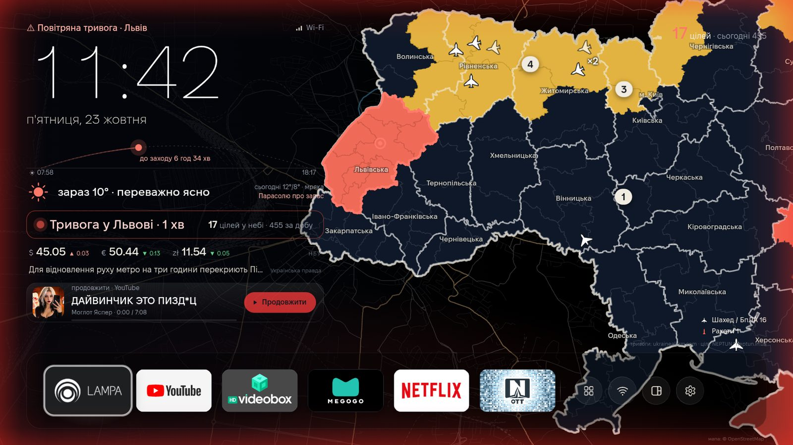 Тривога у вашому місті | 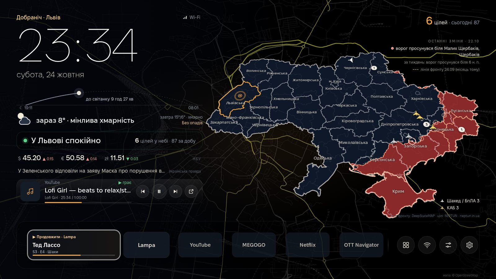 Лінія фронту DeepStateMAP і зміни за добу |
| 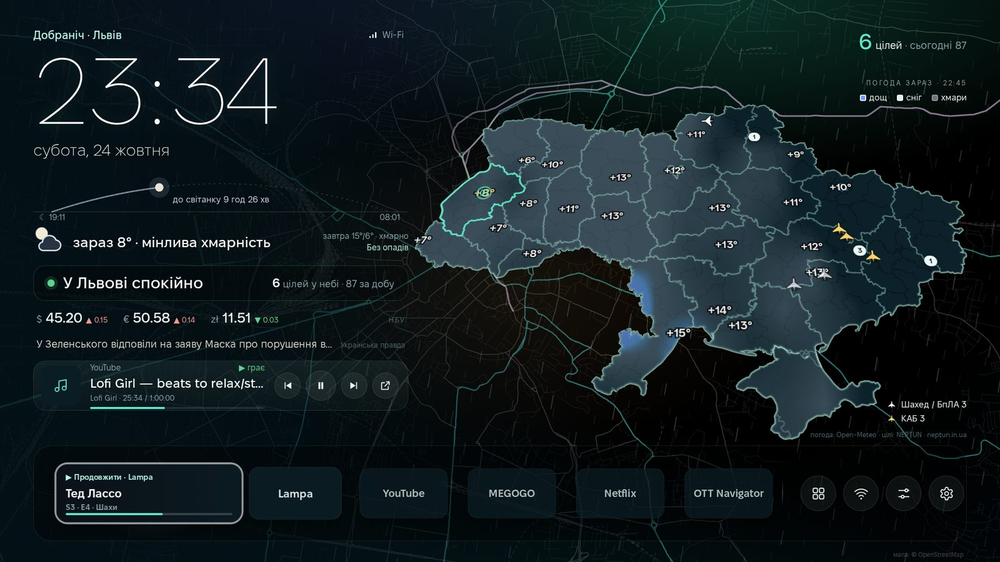 Погода над Україною, дощ на фоні | 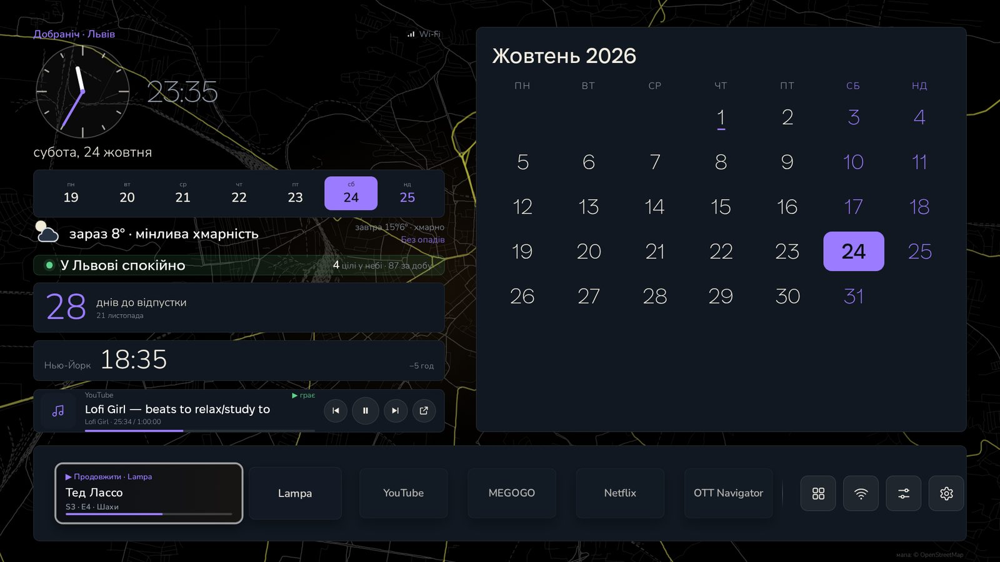 Екран із конструктора: стрілки, тиждень, відлік, календар |
| 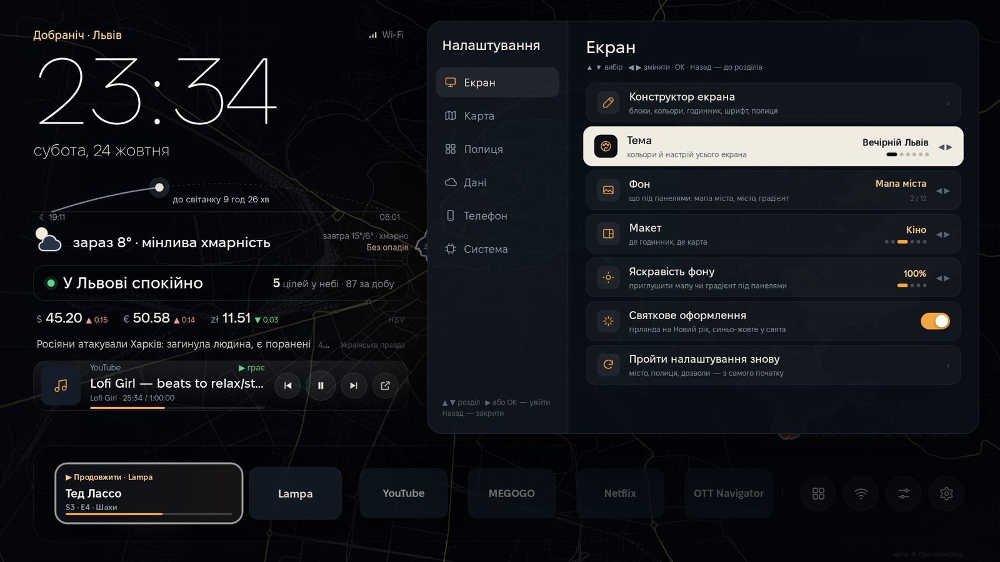 Налаштування з розділами — екран видно поруч | 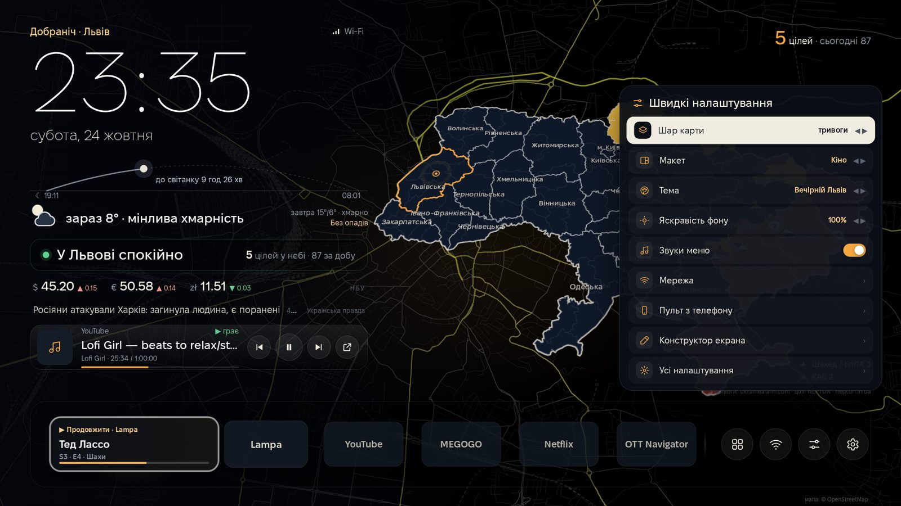 Швидкі налаштування з полиці |
| 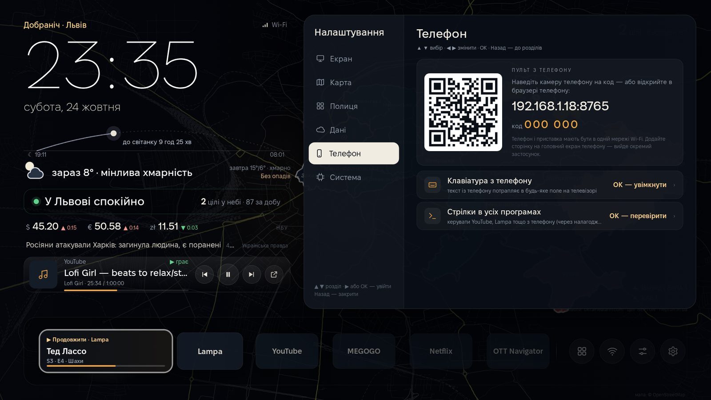 Пульт з телефону: QR-код і код | 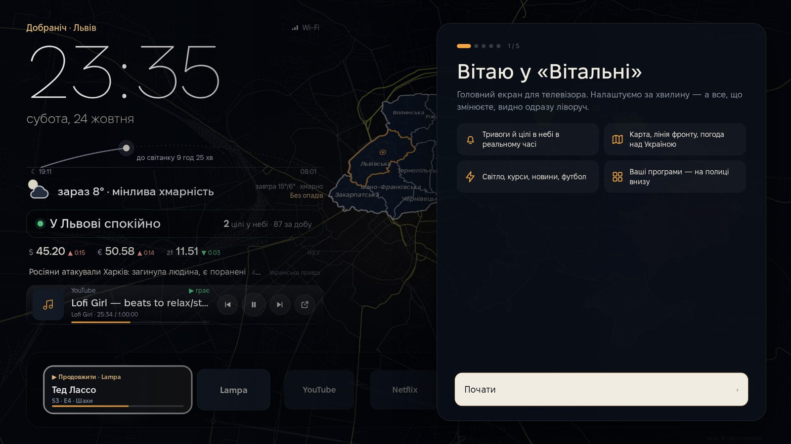 Перше налаштування |
| 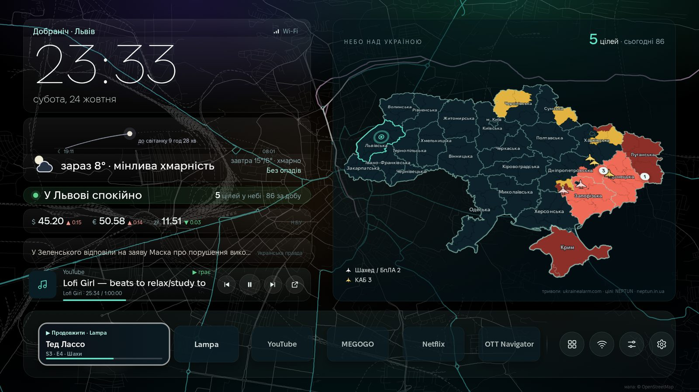 «Північне сяйво», макет «Картки» | 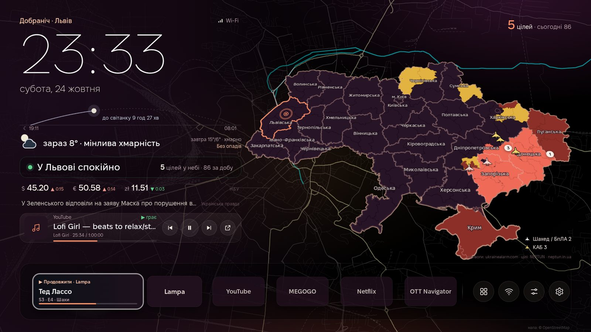 «Захід над Карпатами» |
| 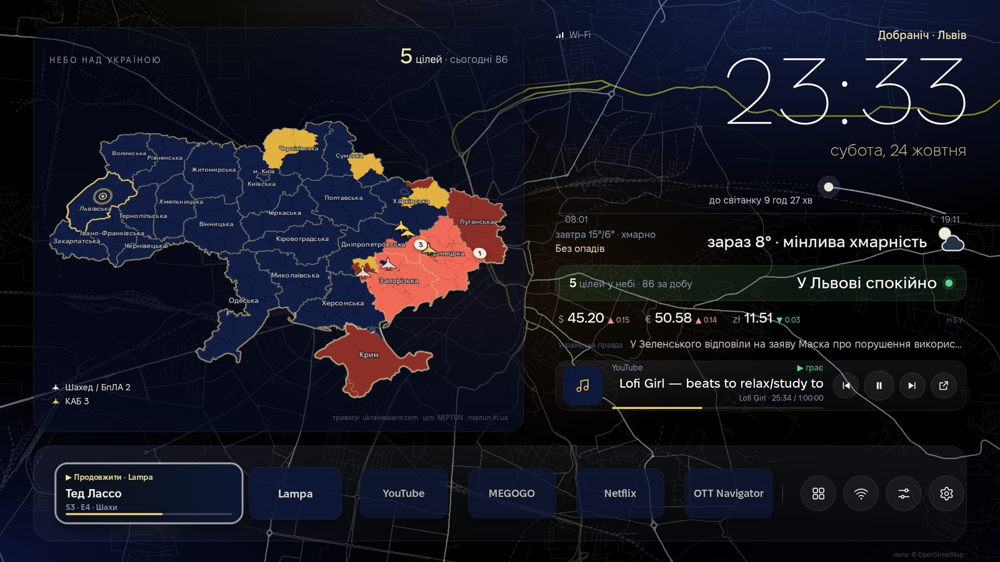 «Сапфір і золото», макет «Дзеркало» | 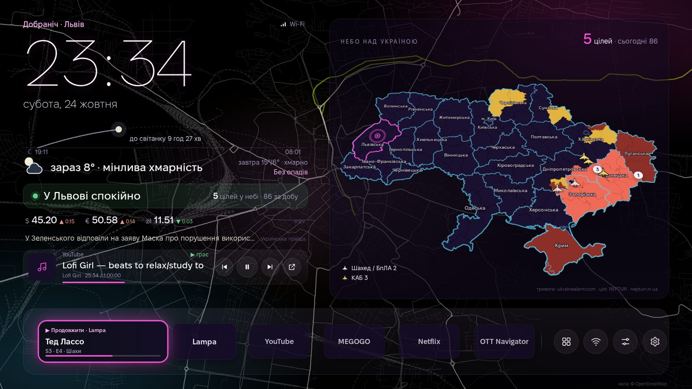 «Неон» |
| 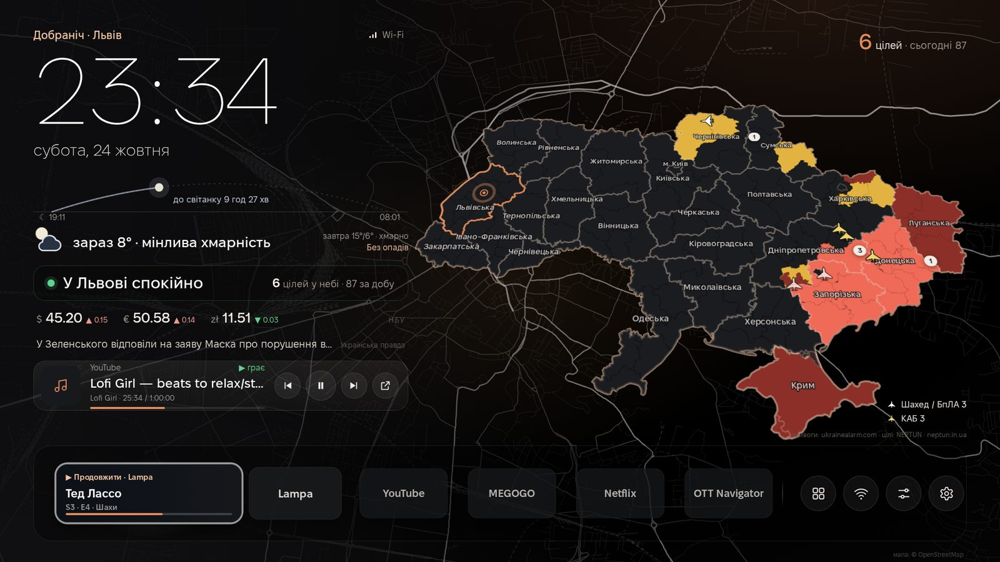 «Графіт і мідь» | 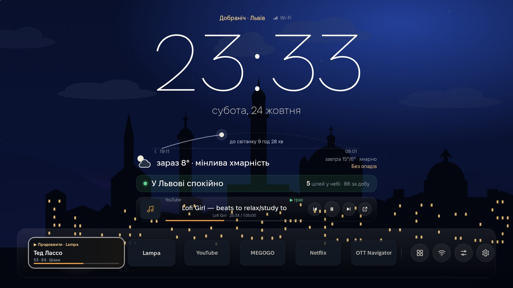 Макет «Мінімал» |

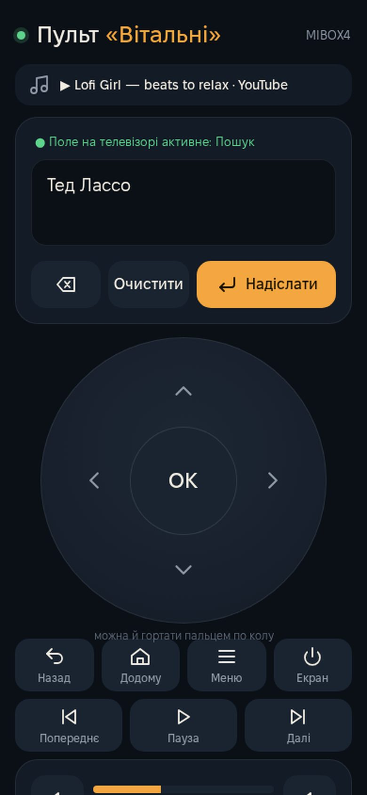 &nbsp; Пульт на телефоні: текст одразу з’являється в полі на телевізорі.

## Дві версії

| | Повна | Lite |
|---|---|---|
| Пакет | `pl.pichkur.tvhome` | `pl.pichkur.tvhome.lite` |
| Кнопка Home відкриває Вітальню на будь-якій приставці | так (служба спеціальних можливостей) | лише якщо система дозволяє вибрати лаунчер |
| «Чубчик» тривоги поверх інших програм | так | ні |
| Міні-плеєр з назвою треку | так (доступ до сповіщень) | ні |
| Google Play Protect | може попереджати | без попереджень |

## Як це влаштовано

```
android/   APK: повноекранний WebView + міст window.TV (програми, запуск, Wi-Fi, медіа),
           DataService (усі дані збирає сама приставка), HomeGuardService (кнопка Home, «чубчик»),
           самооновлення через PackageInstaller. Дві збірки: full і lite (Gradle flavors).
web/       сам екран: HTML/CSS/JS без фреймворків, вшивається в APK (assets/web).
           Карта — SVG з геометрії ukrainealarm, мапи вулиць — з OpenStreetMap.
server/    невеликий Node-сервер без залежностей: публічний API для того, чого немає у відкритому
           доступі (тривоги по громадах, лінія фронту, графіки світла), плюс сайт із завантаженням.
site/      сайт tvhome.pichkur.com.
tools/     збирання карти й мап вулиць, публікація APK.
```

Публічні ендпоінти (`https://tvhome.pichkur.com`):

| | |
|---|---|
| `/api/public/alerts` | тривоги по областях, районах і громадах |
| `/api/public/frontline` | лінія фронту (SVG-шляхи в координатах карти) і зміни за тиждень |
| `/api/public/power?region=lviv` | графіки відключень для області |
| `/api/public/wxmap` | опади й хмари над Україною (PNG у координатах карти), температура в містах |
| `/api/public/football?team=134426` | наступний, останній і поточний матч команди |
| `/api/public/version`, `/api/public/download/tvhome.apk` | оновлення |

### Збирання

APK збирається в Codemagic (`codemagic.yaml`): `./gradlew :app:assembleFullRelease :app:assembleLiteRelease`.
Для підпису потрібна група змінних `tvhome_signing` з `TVHOME_KEYSTORE_B64`, `CM_KEYSTORE_PASSWORD`,
`CM_KEY_ALIAS`, `CM_KEY_PASSWORD`. Без них Gradle підпише debug-ключем — для власної приставки цього досить.

Локально: `cd android && ./gradlew :app:assembleFullDebug`, потім

```bash
adb install -r app/build/outputs/apk/full/debug/app-full-debug.apk
adb shell cmd package set-home-activity pl.pichkur.tvhome/.MainActivity
adb shell settings put secure enabled_accessibility_services pl.pichkur.tvhome/.HomeGuardService
```

Сервер: `docker compose up -d --build` (порт 8098). Сторінку можна переглянути в браузері
з `?demo` — з'являться тестовий плеєр і полиця.

## Джерела даних

- Тривоги — [map.ukrainealarm.com](https://map.ukrainealarm.com); запасний варіант по областях — ubilling.
- Цілі в небі — [NEPTUN](https://neptun.in.ua) (за умовами використання посилання на NEPTUN завжди видно на екрані).
- Лінія фронту — [DeepStateMAP](https://deepstatemap.live).
- Відключення світла — [svitlo](https://github.com/menstryo/svitlo) (дані обленерго, ДТЕК, YASNO).
- Футбол — [TheSportsDB](https://www.thesportsdb.com).
- Погода — [Open-Meteo](https://open-meteo.com), курси — НБУ, новини — RSS «Української правди» та Укрінформу.
- Мапи вулиць — © учасники [OpenStreetMap](https://www.openstreetmap.org/copyright), ODbL.
- Шрифти — [Fixel](https://fixel.macpaw.com) від MacPaw (`site/fonts/OFL-Fixel.txt`), JetBrains Mono, Lora, Nunito, [DSEG7](https://github.com/keshikan/DSEG) — усі SIL Open Font License.
- Фото дня — [Вікіпедія / Wikimedia Commons](https://commons.wikimedia.org) (автор і ліцензія показуються під фото).

Дані належать їхнім власникам. Вітальня лише показує їх; у разі тривоги орієнтуйтеся на офіційні сигнали.

## Ліцензія

Код — [MIT](LICENSE).
